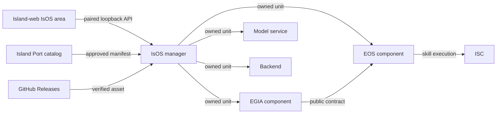

# IsOS platform integration plan

[中文](../../../docs_cn/isos/maintenance/plan_cn.md)

IsOS is the local manager for an Island deployment. EOS supplies the runtime and native skills; EGIA supplies the agent; Island-models supplies model services; Island Port approves package metadata; Island-web provides the hosted manager interface. This page records the working boundary and the remaining release gates. The [graph](../interfaces/deployment-graph.md), [package manifest](../interfaces/releases.md), and [local API](../interfaces/local-api.md) pages are the normative wire contracts.

## Ownership and names

| Owner | Responsibility | Operator surface |
| --- | --- | --- |
| IsOS | Installed release store, deployment graph, config generation, process ownership, local API | `isos` and the IsOS WebUI area |
| EOS | Runtime contracts, Inner Skills Community (ISC), native skill execution, diagnostic client | `eos`, `eos-cli`, `ss`, `top` |
| EGIA | Agent planning and capability use through the EOS public contract | `egia` and the EGIA operator page |
| Island-models | Model weights and one managed model server per service alias | IsOS `services` nodes |
| Island Port | Reviewed catalog and release approval | os-island.com package center |

The **skills library** is IsOS's installed package collection and graph selection. ISC is EOS's internal communication mechanism for running skills. `ss` displays skill executions; `top` follows that monitor. Neither monitor owns package installation. The **services library** replaces the old “models manager” name because a model may be served by several processes or environments. The **backends library** contains hardware and simulator providers. EOS and EGIA remain **components** rather than backends.

## CLI and lifecycle

The primary command is `isos`. `isos packages` handles generic discovery, exact-version install, verify, list, link, and remove. `isos skills`, `isos services`, and `isos backends` show graph-scoped resources and offer kind-checked package operations. `isos config init|validate|apply|show` owns the JSON graph. `isos start|stop|restart|status|logs` owns the whole deployment; `isos eos` and `isos egia` scope component operations. `isos doctor` checks local prerequisites. `isos ui` starts the paired loopback API; `isos daemon` exposes the owner-only Unix socket.

The friendly `eos start` and `eos enter` commands delegate to IsOS. `enter` attaches to an already running EOS and never starts one. The native diagnostic program is surfaced as `eos-cli`; `eos-repl` remains a compatibility name. Inside the CLI, `leave`, `quit`, and `exit` close only that session. `shutdown` tells IsOS to stop EOS, its dependent nodes, and deployment-owned prerequisites, closes sessions entered through IsOS, and preserves separately started or shared services. Active state stores the graph snapshot used to start the deployment, so editing a selected graph cannot redirect a later stop.

There is no prelaunch hook in EOS or EGIA for IsOS deployments. A service, skill, or backend that must be ready first is an explicit graph node with a consumer-to-provider edge and readiness condition. IsOS starts providers first and stops dependents first. Failure to start rolls back units started in that operation; a unit without an IsOS ownership record is never adopted or killed by matching its name or port.

## Packages and config graph

Island Port is the authority for approved releases and GitHub Releases is the default asset host. Manifest schema v4 pins package ID, kind, SemVer, source commit, runtime contracts, target matrix, byte size, and SHA-256. IsOS downloads and verifies an exact platform asset before placing it in the user-local store. A local candidate can be installed only with the explicit `--allow-unapproved` path. Install alone does not activate or restart anything.

The versioned JSON graph is the source of deployment truth. Nodes select `component`, `service`, `backend`, or `skill`, optionally pin an installed package, describe launch arguments and environment, and state ownership. Edges express `depends_on`, `model_binding`, `backend_attachment`, or `skill_load`. Config apply validates the graph, renders package activation TOML and a generated EOS stack, and saves the selected graph. A running deployment changes only after an explicit stop/restart. The WebUI edits the same JSON through the local API: one row per package opens details, while the graph page edits nodes and edges and shows apply errors.

Python 3.12 is the default for Python components. Launch commands and service environment may select uv, Conda, or an absolute interpreter; IsOS does not bind them to system Python. Native backend packages declare their actual Linux architecture, libc, shared-library, GPU, and ROS requirements. A release claims only platforms and Ubuntu versions tested with those exact bytes.

## Rust, C++, and Python boundary

Rust is the better fit for IsOS's package verification, path validation, graph planning, lifecycle state, and authenticated local API: these manipulate untrusted metadata and long-lived ownership records. C++ remains the better fit for the existing EOS runtime, hardware modules, realtime paths, and native skill ABI. Using both avoids rewriting the mature runtime while giving the manager a smaller memory-safe control plane.

The default boundary is a supervised process plus a versioned JSON/Unix-socket or EOS public RPC contract. This keeps failure and allocator ownership isolated. The EOS shared skill SDK exposes a small native ABI. The next Python external-skill adapter should run Python 3.12 in its own IsOS-owned worker and use pybind11 **inside that worker** to bind the C++ SDK. It must load only admitted skills and preserve EOS's isolation policy; exposing a Python import in the manager process would bypass that boundary.

If measured latency later requires in-process Rust/C++ calls, add a versioned C ABI with opaque handles, explicit create/destroy functions, caller-owned input buffers, callee-owned output buffers released by the callee, bounded lengths, status codes, and no exceptions across the boundary. Never pass C++ objects, Rust references, or Python objects over FFI. Test it with sanitizers, malformed-buffer fuzzing, concurrent shutdown, and ABI version negotiation before using it for release code. Rust's existing `Island` Origin supervisor is not the IsOS manager and is not an FFI shortcut.

## Repository delivery and gates

1. **Manager baseline — implemented.** IsOS has a clean standalone Rust repository, graph/release contracts, a verified store, scoped libraries, user-systemd ownership, CLI attachment, and a paired local API. Its unit suite, live ownership smoke, and MuJoCo local install/apply smoke pass.
2. **EOS adapter — implemented in private development.** The EOS CLI and REPL lifecycle delegate to IsOS, `ss`/`top` cover skill monitoring, and the C++ native skill SDK has a shared companion. Publish a new Aether-EOS-R snapshot only after its own clean release qualification; the existing public tag is immutable.
3. **EGIA adapter — EOS 2 development port implemented.** EGIA now uses `CapabilityService` and generated EOS 2 bindings, with authorization, robot/device identity, operation outcome, and timeout checks. The port passed the full EGIA suite and a real simulator/eosd process smoke against the exact untagged EOS development commit `c43e5a32eafd9bf22b2dba2940662dcded60111c`. Aether-EOS-R `v1.0.0` remains EOS v1 and is not compatible with this port. Aether-EGIA-R is an untagged candidate; public release and EOS 2 release compatibility remain gated on a published/tagged EOS 2 release and the EGIA release checklist.
4. **Services, catalog, and simulator — implemented adapters.** Island-models exposes catalog/preflight and managed one-service launch. Island Port accepts v4 manifests. MuJoCo has a `v1.0.1` candidate builder and tested x86_64 archive; publish the GitHub asset only after target qualification and review of the exact digest. Do not infer aarch64 support.
5. **WebUI — manager and EGIA northbound migration implemented.** Island-web has bilingual IsOS pages, local pairing, package detail rows, graph editing, and an EGIA console that uses the authenticated IsOS loopback WebSocket bridge. The bridge restricts target selection to the enabled EGIA component's loopback `launch.ready_tcp` and fixed northbound routes. Browser permission behavior and live hardware/runtime interaction still need validation on supported desktop browsers and an EGIA deployment.
6. **External skills and release automation — open.** Add the pybind11 worker behind admission and sandbox boundaries, publish approved skill packages, automate source snapshot/audit steps, and add cross-repository smoke tests for install, apply, start, enter, shutdown, rollback, and uninstall on every qualified Linux target.

Each repository updates its own interface docs and English/Chinese task guides in the same PR as a behavior change. Development commits stay in private histories; public Aether release repositories receive independently reviewed source snapshots. Merge feature branches by squash after formatting, static checks, unit tests, platform qualification, and the relevant integration checks pass. A release tag follows the reviewed public commit and exact asset upload; it never substitutes for those gates.
