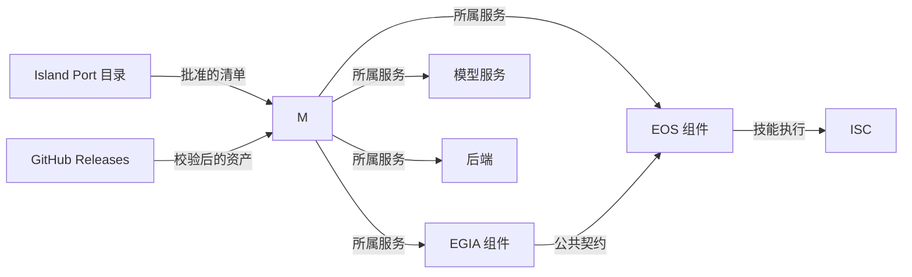

# IsOS 平台集成计划

[English](../../../docs/isos/maintenance/plan.md)

IsOS 是 Island 部署的本地管理器。EOS 提供运行时和原生技能，EGIA 提供智能体，Island-models 提供模型服务，Island Port 审核软件包元数据，Island-web 提供托管的管理界面。本文记录已实现的边界与剩余发布关卡。具体字段以[部署图](../interfaces/deployment-graph_cn.md)、[发行清单](../interfaces/releases_cn.md)和[本地 API](../interfaces/local-api_cn.md)为准。

## 职责与命名

| 所属项目 | 职责 | 操作入口 |
| --- | --- | --- |
| IsOS | 已安装发行版、部署图、配置生成、进程所有权、本地 API | `isos` 命令行与仅所有者可访问的 Unix socket |
| EOS | 运行时契约、内部技能社区（ISC）、原生技能执行、诊断客户端 | `eos`、`eos-cli`、`ss`、`top` |
| EGIA | 通过 EOS 公共契约进行规划和能力调用 | `egia` 与 EGIA 操作页面 |
| Island-models | 模型权重及每个别名对应的托管服务 | IsOS 的 `services` 节点 |
| Island Port | 已审核目录及发行审批 | os-island.com 软件包中心 |

**技能库**是 IsOS 中已安装的软件包和部署图选择；ISC 是 EOS 中运行技能的内部通信机制。`ss` 显示技能执行，`top` 持续刷新同一监视器，二者不负责安装。**服务库**取代旧的“模型管理器”名称，因为一个模型可能由多个进程或环境提供。**后端库**收纳硬件与仿真提供者。EOS 和 EGIA 属于**组件**。

## 命令与生命周期

主要入口是 `isos`。`isos packages` 处理通用发现、精确版本安装、校验、列表、开发链接与移除。`isos skills`、`isos services`、`isos backends` 查看部署图中各类资源并执行类型检查后的软件包操作。`isos config init|validate|apply|show` 管理 JSON 图；`isos start|stop|restart|status|logs` 管理整个部署；`isos eos`、`isos egia` 限定组件；`isos doctor` 检查本地条件；`isos daemon` 提供仅所有者可访问的 Unix socket。

易用入口 `eos start` 与 `eos enter` 委托给 IsOS。`enter` 只连接正在运行的 EOS，不会隐式启动。诊断程序面向用户的名称是 `eos-cli`；`eos-repl` 保留兼容名称。CLI 内的 `leave`、`quit`、`exit` 只关闭当前会话。`shutdown` 通知 IsOS 停止 EOS、依赖 EOS 的节点以及部署所属前置服务，并关闭由 IsOS 进入的会话；独立或共享服务继续运行。活动状态保存启动时的图快照，防止编辑后的图改变停止目标。

IsOS 部署不使用 EOS 或 EGIA 的预启动钩子。需要先就绪的服务、技能或后端应成为显式图节点，并添加从使用者指向提供者的边和就绪条件。IsOS 先启动提供者、先停止依赖者；启动失败时回滚此次启动的服务。未记录所有权的服务不会因名称或端口相似而被接管或终止。

## 软件包与配置图

Island Port 是已批准发行版的目录权威，GitHub Releases 是默认资产宿主。v4 清单固定软件包 ID、类别、语义版本、源码提交、运行时契约、平台矩阵、字节大小与 SHA-256。IsOS 先校验平台和文件，再放入用户本地库。未批准的本地候选版必须显式使用 `--allow-unapproved`。安装本身不会激活或重启服务。

版本化 JSON 图是部署的权威配置。节点选择 `component`、`service`、`backend` 或 `skill`，可固定已安装版本，声明启动参数、环境及所有权。边表达 `depends_on`、`model_binding`、`backend_attachment` 或 `skill_load`。配置应用先校验图，再渲染软件包激活 TOML 与 EOS 栈文件，最后保存选中的图；运行中的部署只有显式停止或重启才变化。本地客户端可使用[本地 API 契约](../interfaces/local-api_cn.md)描述的 Unix socket。

Python 组件默认使用 Python 3.12。启动命令和服务环境可选择 uv、Conda 或绝对解释器路径；IsOS 不绑定系统 Python。原生后端清单声明实际测试的 Linux 架构、libc、动态库、GPU 与 ROS 要求。发行版只声明用相同字节实际测试过的平台和 Ubuntu 版本。

## Rust、C++ 与 Python 边界

Rust 适合 IsOS 的软件包校验、路径校验、图规划、生命周期状态和本地 API，因为这些功能处理不可信元数据与长期所有权。C++ 继续承担成熟的 EOS 运行时、硬件模块、实时路径和原生技能 ABI。两种语言并用，可以保留现有运行时并让控制面更小、更安全。

默认边界是受管理的独立进程，加版本化 JSON/Unix socket 或 EOS 公共 RPC 契约。这样可隔离故障和分配器所有权。EOS 已提供小型原生技能 SDK。下一步的 Python 外部技能适配器应运行在独立、由 IsOS 管理的 Python 3.12 工作进程内，并只在该进程内用 pybind11 绑定 C++ SDK；它必须只加载已准入技能并保留 EOS 隔离策略。直接在管理器进程中导入 Python 会绕过此边界。

如果将来测量表明必须进行进程内 Rust/C++ 调用，再增加版本化 C ABI：不透明句柄、明确的创建与销毁、调用者持有的输入缓冲区、由提供者释放的输出缓冲区、有界长度、状态码，并禁止异常跨越边界。不得通过 FFI 传递 C++ 对象、Rust 引用或 Python 对象。发布前需完成 sanitizer、异常缓冲区模糊测试、并发关闭和 ABI 版本协商。现有 Rust `Island` Origin 监控器不属于 IsOS，也不是绕过边界的 FFI 方案。

## 仓库交付与发布关卡

1. **管理器基础：已实现。** IsOS 有独立 Rust 仓库、配置图和发行契约、校验后的库、分类命令、systemd 用户服务所有权、CLI 连接和仅所有者可访问的 Unix socket API。单元测试、真实服务所有权冒烟测试及 MuJoCo 本地安装与应用检查通过。
2. **EOS 适配：私有开发仓库已实现。** EOS CLI 和 REPL 生命周期委托 IsOS，`ss`/`top` 监控技能执行，C++ 原生技能 SDK 提供共享库。现有 Aether-EOS-R 公共标签不可改；新的公共快照需要独立资格验证。
3. **EGIA 适配：EOS 2 开发版移植已实现。** EGIA 现在使用 `CapabilityService` 和生成的 EOS 2 绑定，并检查授权、机器人/设备身份、操作结果及超时。该移植已通过 EGIA 全量测试，并针对未打标签的 EOS 开发提交 `c43e5a32eafd9bf22b2dba2940662dcded60111c` 完成模拟器/eosd 真实进程冒烟测试。Aether-EOS-R `v1.0.0` 仍是 EOS v1，与本移植不兼容。Aether-EGIA-R 仍是未打标签的候选；公开发布及 EOS 2 发行版兼容性仍需等待已发布/打标签的 EOS 2，并通过 EGIA 发布清单。
4. **服务、目录与仿真：适配已实现。** Island-models 提供目录、预检和单服务托管启动；Island Port 接受 v4 清单；MuJoCo 有 `v1.0.1` 候选构建器与 x86_64 测试资产。上传 GitHub 资产前须审核目标平台和精确摘要，不推断 aarch64 支持。
6. **外部技能及发布自动化：待完成。** 在准入和沙箱边界后增加 pybind11 工作进程，发布批准的技能包，自动化源码快照与审计，并在每个合格 Linux 目标上执行安装、应用、启动、连接、关闭、回滚、卸载的跨仓库冒烟测试。

每个仓库在行为修改的同一 PR 中更新自己的接口文档和中英文任务指南。开发提交保留在私有历史；公共 Aether 发行仓库接收独立审核的源码快照。格式化、静态检查、单元测试、平台资格和相关集成检查通过后，使用 squash 合并功能分支。发行标签应在已审核的公共提交和精确资产上传后创建，不能取代这些关卡。
